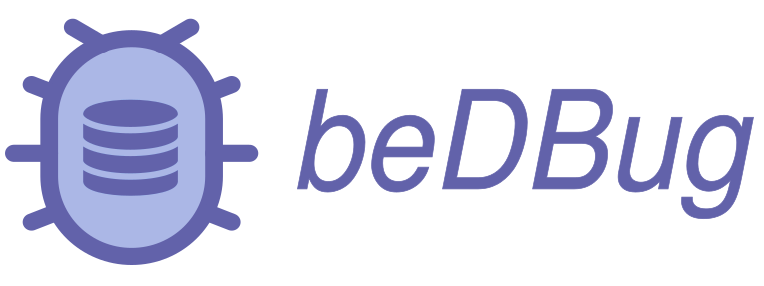

<div align="center">



**Design your database visually. Generate the SQL. Keep the diagram.**

A fast, native, cross-platform desktop app for database design — entity-relationship
diagrams with crow's-foot notation, engine-neutral schema modelling, and deterministic
SQL DDL generation.

</div>

---

> [!NOTE]
> beDBug is in active development. The editor, canvas, relationships, undo/redo,
> document lifecycle, live SQL preview, and PostgreSQL/MySQL engine switching work today;
> the type-advisory panel and PDF export are next. See the [roadmap](#roadmap).

## Why beDBug?

Most diagram tools draw boxes. beDBug treats the diagram as a schema: relationships are
foreign keys, column types are engine-neutral, and the generated DDL is a first-class
output rather than an afterthought.

- **Built for real schemas** — primary keys, unique columns, defaults, nullability,
  indexes, and foreign keys are part of the model, not annotations.
- **Engine-neutral by design** — one canonical type system, mapped to each dialect at
  export time, so switching engines never forces you to redraw.
- **Native and quick** — C++20 and Qt 6 Widgets on top of `QGraphicsScene`, no browser
  runtime, no Electron.
- **Your data stays yours** — plain JSON documents you can read and diff.

## Features

| | |
|---|---|
| **ER diagram canvas** | Grid, snapping, zoom, pan, fit-to-window, A4-sheet canvas with adjustable page size. |
| **Table editing** | Live table cards, column editor, PK/unique/auto-increment handling, enum values, configurable PK naming. |
| **Relationships** | 1:1, 1:N and N:M tools with crow's-foot (IE) notation, orthogonal routing, optional direction arrows, and FK columns resolved automatically. |
| **Undo / redo** | Every structural and geometric edit goes through a command stack. |
| **Documents** | New / Open / Save / Save As, dirty tracking, recent session restore, single-file JSON format. |
| **SQL generation** | Live read-only SQL preview with syntax highlighting, Copy and Save; switch between PostgreSQL and MySQL in one click. Dependency-ordered tables, indexes, and cycle-safe foreign keys, covered by golden-file tests. |
| **Themes** | Calm default palette plus several dark themes, switchable from Settings. |
| **Tests** | Headless model, serialization, SQL and command tests wired into CTest. |

## Getting started

### Build from source

**Requirements**

- CMake 3.28+
- A C++20 compiler (GCC 12+, Clang 15+, MSVC 2022)
- Qt 6.8+ with the `Core`, `Gui`, `Widgets`, `PrintSupport`, `Sql`, and `Test` modules
- Ninja (recommended)

**Linux (Fedora)**

```bash
sudo dnf install qt6-qtbase-devel qt6-qtsvg-devel ninja-build gcc-c++
```

**Linux (Debian / Ubuntu)**

```bash
sudo apt install qt6-base-dev qt6-svg-dev ninja-build g++ cmake
```

**macOS**

```bash
brew install qt@6 cmake ninja
```

**Windows** — install Qt 6.8+ through the [Qt Online Installer](https://www.qt.io/download-qt-installer),
then use the "Qt 6.x.x (MSVC 2022 64-bit)" kit from a Developer PowerShell.

**Configure, build, and run**

```bash
./build.sh Release              # configure + build + test
./build/src/app/bedbug          # build\src\app\Release\bedbug.exe on Windows
```

Or run the CMake steps yourself:

```bash
cmake -S . -B build -G Ninja -DCMAKE_BUILD_TYPE=Debug
cmake --build build
./build/src/app/bedbug        # build\src\app\Release\bedbug.exe on Windows
```

### Planned for the first release

- Additional dialects (MariaDB, SQL Server, SQLite)
- PDF export of the diagram
- Advisory panel for lossy type mappings and unresolved decisions


## Usage

1. **Add a table** from the toolbar or the table context menu.
2. **Edit columns** in the Entity Editor dock — set types, keys, indexes, and defaults.
3. **Draw relationships** with the 1:1 / 1:N / N:M tools, then click the parent and child
   tables. beDBug adds the foreign-key column for you.
4. **Save** the diagram as a `.json` document. Your session is restored on relaunch.
5. **Open the SQL Preview dock** (View → SQL Preview) to see the DDL update live; pick
   the target engine from the toolbar selector, then use **Copy** or **Save…**.

### Keyboard shortcuts

| Action | Shortcut |
|---|---|
| New / Open / Save | `Ctrl+N` / `Ctrl+O` / `Ctrl+S` |
| Save As | `Ctrl+Shift+S` |
| Undo / Redo | `Ctrl+Z` / `Ctrl+Shift+Z` |
| Add table | `Ctrl+T` |
| 1:N relationship tool | `Ctrl+L` |
| Zoom in / out / fit | `Ctrl++` / `Ctrl+-` / `Ctrl+0` |
| Pan canvas | Right-drag, middle-drag, `Space`+drag, or `Shift`+wheel |
| Cancel current tool | `Esc` |

## Testing

```bash
ctest --test-dir build --output-on-failure
```

The SQL generator is verified against golden files in [`tests/golden`](tests/golden)
(simple schemas, composite foreign keys, cycles, and the full canonical type matrix).

## Project layout

```
bedbug/
├── CMakeLists.txt            # top-level project, Qt setup, tests
├── src/
│   ├── core/                 # model, canonical types, JSON — QtCore only, no UI
│   ├── sqlgen/               # dialect interface, registry, PostgreSQL + MySQL generators
│   ├── document/             # document controller, undo/redo commands
│   ├── canvas/               # QGraphicsScene/View, entity items, crow's-foot edges
│   ├── app/                  # main window, dialogs, themes, application entry point
│   └── resources/            # QSS themes and icons
├── tests/                    # core, sqlgen, canvas, document and app tests + fixtures
├── PLAN.md                   # product plan and design decisions
└── IMPLEMENTATION.md         # milestone-by-milestone execution plan
```

## Roadmap

- [x] M0 — CMake skeleton and toolchain
- [x] M1 — Core model, canonical types, JSON round-trip
- [x] M2 — PostgreSQL DDL generation with golden tests
- [x] M3 — Canvas, tables, zoom/pan/snap
- [x] M4 — Relationships, crow's-foot notation, cascade rules
- [x] M5 — Undo/redo command stack
- [x] M6 — File lifecycle and session restore
- [ ] M7 — SQL preview, engine switching, type advisories (preview + switching done)
- [ ] M8 — PDF export
- [ ] M9 — Thin-slice hardening

The full plan, including architectural decisions and trade-offs, lives in
[`PLAN.md`](PLAN.md).

## Contributing

Contributions are welcome. Before opening a pull request:

1. Fork the repo and create a branch from `master`.
2. Keep changes focused, and follow the existing C++/Qt style.
3. Run `ctest --test-dir build --output-on-failure` — new core and SQL logic should come
   with tests.
4. Describe the *why* in the PR, and link the related issue.

Found a crash, a rendering glitch, or a schema that generates bad SQL? Please
[open an issue](https://github.com/EliPoli64/bedbug/issues/new?labels=bug) with your
document file if possible.

## Acknowledgements

- [Qt 6](https://www.qt.io/) — the UI toolkit (LGPLv3, dynamically linked).
- [qt-dark-theme](https://github.com/keshav-sahu7/qt-dark-theme) by Keshav Sahu — vendored
  dark themes and icons; see [`src/resources/LICENSE-qt-dark-theme`](src/resources/LICENSE-qt-dark-theme).

## License

beDBug is released under the [MIT License](LICENSE).
